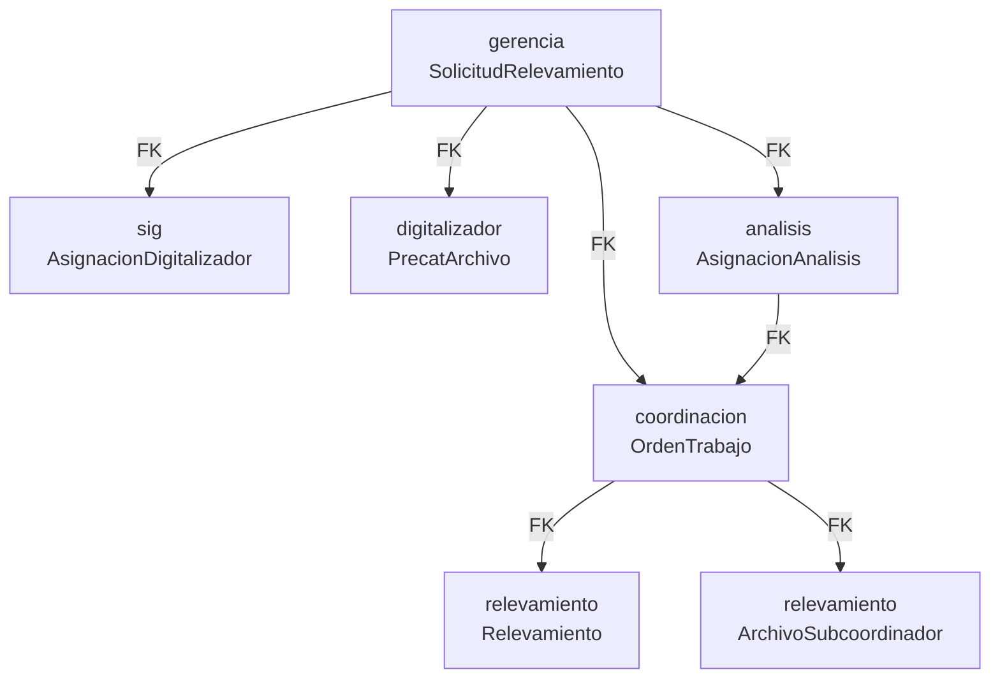

Ran Get architecture 
Completed with input: {
  "aspects": [
    "overview",
    "dependencies",
    "boundaries",
    "layers",
    "clusters"
  ],
  "path": "gerencia",
  "project": "C-gestion_de_tierras"
}

Ran Get architecture 
Completed with input: {
  "aspects": [
    "overview",
    "dependencies",
    "boundaries",
    "layers",
    "clusters"
  ],
  "path": "coordinacion",
  "project": "C-gestion_de_tierras"
}

Ran Get architecture 
Completed with input: {
  "aspects": [
    "overview",
    "dependencies",
    "boundaries",
    "layers",
    "clusters"
  ],
  "path": "sig",
  "project": "C-gestion_de_tierras"
}

Ran Get architecture 
Completed with input: {
  "aspects": [
    "overview",
    "dependencies",
    "boundaries",
    "layers",
    "clusters"
  ],
  "path": "digitalizador",
  "project": "C-gestion_de_tierras"
}

Ran Get architecture 
Completed with input: {
  "aspects": [
    "overview",
    "dependencies",
    "boundaries",
    "layers",
    "clusters"
  ],
  "path": "relevamiento",
  "project": "C-gestion_de_tierras"
}

Ran Get architecture 
Completed with input: {
  "aspects": [
    "overview",
    "dependencies",
    "boundaries",
    "layers",
    "clusters"
  ],
  "path": "analisis",
  "project": "C-gestion_de_tierras"
}

Ahora leo los modelos de cada módulo para entender las FK y relaciones cruzadas:   

Read [](file:///c%3A/gestion_de_tierras/gerencia/models.py#1-1), lines 1 to 100

Read [](file:///c%3A/gestion_de_tierras/coordinacion/models.py#1-1), lines 1 to 100

Read [](file:///c%3A/gestion_de_tierras/relevamiento/models.py#1-1), lines 1 to 100

Read [](file:///c%3A/gestion_de_tierras/gerencia/models.py#100-100), lines 100 to 120

Read [](file:///c%3A/gestion_de_tierras/coordinacion/models.py#100-100), lines 100 to 180

Read [](file:///c%3A/gestion_de_tierras/relevamiento/models.py#100-100), lines 100 to 220

Read [](file:///c%3A/gestion_de_tierras/sig/models.py)

Read [](file:///c%3A/gestion_de_tierras/digitalizador/models.py#1-1), lines 1 to 80

Read [](file:///c%3A/gestion_de_tierras/analisis/models.py)

Searched for regex `orden_trabajo.*ForeignKey|ForeignKey.*OrdenTrabajo` (`**/relevamiento/models.py`), 2 results

Read [](file:///c%3A/gestion_de_tierras/relevamiento/models.py#285-285), lines 285 to 310

Read [](file:///c%3A/gestion_de_tierras/relevamiento/models.py#545-545), lines 545 to 565

Con toda la información recopilada, aquí está el análisis completo:

---

## Relaciones entre módulos — Flujo de trabajo completo

La relación central es una **cadena de estados controlada por `SolicitudRelevamiento`** de gerencia, que pasa secuencialmente por todos los módulos:



---

### gerencia — El núcleo del sistema

`SolicitudRelevamiento` es el **objeto que recorre todo el pipeline**. Define 17 estados que mapean cada etapa de cada módulo. Todos los demás módulos apuntan a él con FK.

También contiene `Objetivo` que monitorea el cumplimiento agregado (conteo de colonias relevadas, encuestas, etc.).

---

### sig — Etapa 1: Digitalización cartográfica

`AsignacionDigitalizador` (FK → `gerencia.SolicitudRelevamiento`) registra la asignación de la solicitud a un digitalizador específico. El flujo de estados dentro de gerencia para esta etapa es:

```
pendiente_asignacion_sig → asignado_a_digitalizador → en_proceso_digitalizacion → pendiente_revision_sig
```

---

### digitalizador — Etapa 2: Carga de archivos Precat

`PrecatArchivo` (FK → `gerencia.SolicitudRelevamiento`) almacena los archivos ZIP/RAR de Precat y PDFs de planos que el digitalizador sube. Contiene metadata geométrica: `lotes_digitalizados`, `calles`, `reservas`, `hectareas_aprox`.

---

### analisis — Etapa 3: Análisis técnico

`AsignacionAnalisis` tiene **doble FK**:
- FK → `gerencia.SolicitudRelevamiento`
- FK → `coordinacion.OrdenTrabajo` *(enlace tardío, se completa una vez generada la OT)*

Esto lo hace el único modelo que "conecta" ambas mitades del flujo (pre-campo y post-campo). Estados en gerencia:

```
pendiente_asignacion_analista → asignado_a_analista → en_proceso_analisis → aprobado_para_campo
```

---

### coordinacion — Etapa 4: Planificación operativa

Una vez aprobada para campo, coordinacion genera una `OrdenTrabajo` (FK → `gerencia.SolicitudRelevamiento`). Esta OT contiene:
- `EquipoRelevamiento` (M2M) — equipos con coordinador_campo, subcoordinadores, encuestadores y choferes
- Fechas planeadas/reales, meta de encuestas
- Control de `formulario_habilitado` para encuestadores

---

### relevamiento — Etapa 5: Trabajo de campo

Relevamiento (FK → `coordinacion.OrdenTrabajo`) es el formulario de encuesta completo (datos del lote, documentos, ocupación, mejoras, equipamientos). La ruta de archivos se construye dinámicamente a partir de la cadena `OT → solicitud → colonia → distrito → departamento`.

`ArchivoSubcoordinador` (FK → `coordinacion.OrdenTrabajo`) permite subir archivos comprimidos del trabajo de campo.

---

### Resumen de dependencias cruzadas

| Módulo | Depende de | Provee a |
|---|---|---|
| gerencia | core, administrador | sig, digitalizador, analisis, coordinacion |
| sig | gerencia | — |
| digitalizador | gerencia | — |
| analisis | gerencia, coordinacion | — |
| coordinacion | gerencia | relevamiento, analisis |
| relevamiento | coordinacion, core, administrador | — |

gerencia y coordinacion son los dos hubs estructurales. El resto son módulos hoja que sólo consumen, sin ser dependidos por otros.